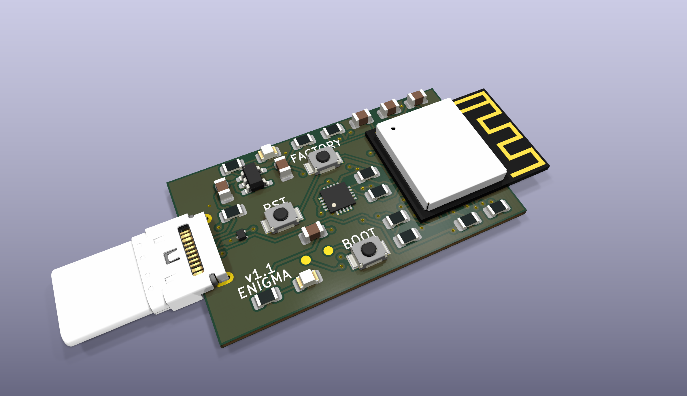

# Enigma Stick

A compact USB-C hardware prototype built around an ESP32-C3-MINI-1 and an NXP SE051 secure element. This repository contains editable KiCad hardware sources, local libraries, preview images, a component list, and build notes. Firmware is developed separately and is not included here.

**Current revision: v1.1, prototype awaiting physical validation.** The base PCB is 34.4 × 20 mm, with the USB plug and antenna extending beyond its edges. ERC/DRC results and outstanding manufacturing checks are described in the [design review](docs/design-review.md). The SE051 rendering is an approximate package model.

## Open the design

1. Install KiCad 10 with its standard symbol, footprint, and 3D libraries. The latest render was made with KiCad 10.0.7.
2. Open [v1.1/enigma-stick-v1.1.kicad_pro](v1.1/enigma-stick-v1.1.kicad_pro) in KiCad's project manager.
3. Follow the [SE051 library setup instructions](docs/se051-library-setup.md) to download and register its standalone symbol and footprint locally; those files are excluded from Git. The design still contains its placed symbol and footprint, as explained in that guide.
4. Open the schematic or PCB from that project. Project-local libraries use relative paths. Some stock/Espressif 3D models require the corresponding installed libraries; missing optional models do not prevent editing the circuit.

Use v1.1 for current work. Konnect is optional for people using KiCad directly.

## Find your way around

| Location | Contents |
| --- | --- |
| [v1.1 project](v1.1/enigma-stick-v1.1.kicad_pro) | Current editable design |
| [Component list](v1.1/manufacturing/JLCPCB-BOM.csv) | Main assembly BOM |
| [Schematic preview](v1.1/reports/schematic.png) | Circuit overview without opening KiCad |
| [docs/build.md](docs/build.md) | Fabrication, assembly and prototype bring-up |
| [docs/design-review.md](docs/design-review.md) | Check results, warning dispositions and open checks |
| [SE051 library setup](docs/se051-library-setup.md) | Download and register the locally installed SE051 library |
| [v1.1/models/](v1.1/models/README.md) | 3D model sources and approximation limits |

## License and attribution

Original Enigma Stick hardware design and project-authored supporting material are licensed under [CERN-OHL-P-2.0](LICENSE). Copyright 2026 Enigma Stick contributors. Third-party libraries and models retain their own terms; see [THIRD_PARTY.md](THIRD_PARTY.md) and [LICENSES/](LICENSES/).
